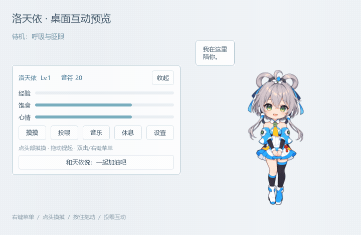

# 洛天依桌宠

Windows 本地音乐桌宠，默认使用经典 V3 公式服精致 Q 版。



## 和天依互动

启动后只显示角色。参考 [VPet 的角色工具栏与气泡交互](https://github.com/LorisYounger/VPet)，常用操作放在角色身边，歌单和设置按需打开。

| 操作 | 效果 |
| --- | --- |
| 点头部 | 摸头、闭眼挥手、爱心和本地对话气泡 |
| 点身体 | 戳一戳，惊讶回应 |
| 按住约 0.28 秒或拖动 | 提起，松开后落地回弹 |
| 拖到屏幕边缘后松手 | 自动吸附，稍后缩成探头；左右、上下边缘均支持 |
| 鼠标靠近探头 / 移开 | 平滑展开 / 稍后缩回；按住拖回桌面可解除吸附 |
| 右键或双击 | 展开/收起贴身菜单 |
| 菜单 → 投喂 | 使用音符兑换点心，播放抱包子动作 |
| 菜单 → 休息 | 闭眼小憩，点击唤醒 |
| 菜单 → 音乐 | 播放控制、歌单与添加 MP3 |
| 菜单 → 设置 | 开机自启、角色大小与更多设置 |

待机有呼吸和眨眼，播放时摇摆并浮出音符。目前使用状态素材切换与程序动作，尚未实现逐帧行走、爬墙、完整舞蹈或骨骼动画；对话为本地预设文本。

停靠使用当前屏幕的可用区域，底部避开任务栏。距离边缘约 32 个逻辑像素内松手会贴边，约 0.9 秒后缩回；互动、气泡、菜单或歌单打开时保持展开。停靠边缘和位置会保存，缩放后仍贴边。透明画布每帧清空，避免动作切换留下旧像素；下拉框和菜单固定使用深色文字、浅色背景与深色选中项。

`characters/` 已预留给自定义角色，接入计划见 [角色包说明](characters/README.md)。当前版本尚未加载外部角色包。

## 开机自启

在“右键天依 → 设置 → 开机自启”打开，或在更多设置中勾选“登录 Windows 后启动桌宠”。默认关闭。

自启只显示桌宠，不打开歌单，也不自动播放音乐，可随时取消。仅使用当前用户的 Windows 登录启动项，无需管理员权限；源码版通过项目虚拟环境的 pythonw.exe 和绝对路径启动，不显示控制台。移动项目或虚拟环境后，需重新开启一次自启。

## 音乐与成长

- 支持导入或拖入 MP3、文件夹当前层的 MP3。
- 支持创建、重命名、删除和切换歌单，搜索、移除和上下移动歌曲；磁盘文件保留。
- 支持顺序播放、列表循环、单曲循环、随机播放、进度拖动和音量。
- 保存上次歌曲、进度和播放方式，重启后点击播放继续；每 15 秒及关闭时保存。
- 旧单列表自动迁移；文件缺失会显示失效，播放时跳过缺失或解码失败的文件。
- 记录今日、本周、累计实际播放时长；暂停、跳进度和休眠间隔不虚增计时。
- 每 5 分钟有效播放获得 5 经验、2 音符，每日最多奖励 120 分钟；静音计时但不发奖。
- 投喂恢复饱食和心情；升级触发回应。摸头心情奖励每日最多 10 次、间隔至少 60 秒，动画互动不限次。

## 运行

Python 3.10 或更高版本，双击“启动桌宠.bat”。首次运行自动安装项目虚拟环境中的 PySide6，需要网络。手动启动：

依赖检查完成后，启动脚本使用窗口模式 Python，不留下控制台窗口。

```powershell
python -m venv .venv
.\.venv\Scripts\python.exe -m pip install -r requirements.txt
.\.venv\Scripts\python.exe main.py
```

更新后从旧桌宠的系统托盘退出，再重新启动。程序只允许一个实例；托盘可找回角色、打开歌单或退出。

## 数据与验证

歌曲保留原位置，设置存于当前用户的 Qt 设置，成长与时长存于本地应用数据目录的 pet.db。程序不上传音乐或听歌记录。

```powershell
.\.venv\Scripts\python.exe -m unittest discover -s tests -v
.\.venv\Scripts\python.exe tests/smoke_ui.py
.\.venv\Scripts\python.exe tests/smoke_edges.py
```

音频和预览测试另外需要开发依赖：

```powershell
.\.venv\Scripts\python.exe -m pip install -r requirements-dev.txt
.\.venv\Scripts\python.exe tests/smoke_playback.py
.\.venv\Scripts\python.exe tests/render_interaction_preview.py
```

23 项逻辑测试、离屏交互检查、本地生成静音 MP3 的解码、计时、跳转、暂停恢复和单曲循环检查已通过。新增检查在离屏及 Windows 窗口后端均通过，覆盖四边探头、展开/缩回、缩放、恢复、拖出停靠、连续绘制清屏，以及深色系统配色下的下拉选项。自启测试使用独立测试注册表位置；实际注销/登录、桌面长时间显示与点击穿透、真实多屏拖拽、扬声器听感尚待验证。

Windows 使用 Qt 原生多媒体后端，见 [Qt 6.8 官方说明](https://doc.qt.io/qt-6.8/qtmultimedia-index.html)。

角色和状态素材用内置 imagegen 生成，参考与实际提示词在 assets/character/；参考图仅保留本地，不随仓库分发。素材为洛天依同人改绘。

项目：[Rhonsua/deskpet](https://github.com/Rhonsua/deskpet)。规则见 [设计方案](洛天依桌宠设计方案.md)，最新方向见 [交互改版记录](交互改版记录.md)。
