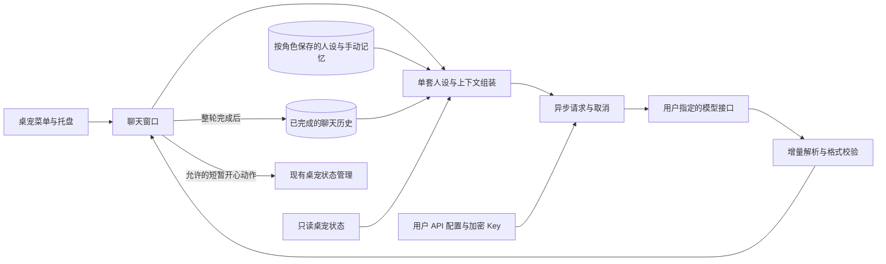

# 桌宠轻量聊天：顶层设计与协作边界

## 目标

用户自行选择模型服务，桌宠提供自然的文字陪伴。保持现有角色优先的使用方式：默认只显示桌宠，需要时打开聊天与设置。洛天依仅有一套完整内置人设，用户可以编辑；不增加多风格预设。没有语音、声库、自动读屏或模型执行电脑操作。

本轮以完善现有实现为范围：修复可复现的可靠性、资料保护和页面响应问题，保持接口与已有存档兼容。

## 模块和信息流

| 层 | 当前模块 | 责任 |
| --- | --- | --- |
| 人设与上下文 | `personality.py`、`personas/luotianyi.json`、`persona.py`、`prompts.py` | 纯数据插件校验、人设与故障回退、陪伴范围、手动记忆、限量近期上下文、有限状态快照 |
| 配置与持久化 | `config.py`、`store.py` | 地址与模型设置、DPAPI Key、完整聊天事务、角色数据隔离 |
| 网络与协议 | `client.py`、`protocol.py` | 异步 HTTP、请求归属、取消、超时、SSE/JSON 校验、服务商专用适配 |
| 交互与呈现 | `window.py` | 页面、输入草稿、编辑保护、流式显示、错误说明 |
| 桌宠集成 | `desktop_pet.py`、`compact_ui.py` | 按需打开、角色切换通知、气泡、受限的临时动作 |

聊天包以 `pet_chat/` 为根，上表相对路径均位于该目录。桌宠集成文件在项目根目录。

## 必须保持的行为

1. **保护用户编辑。** 升级不自动覆盖已保存人设；套用角色默认人设是明确操作且可撤销。保存失败时保留用户草稿，不静默丢弃。用户正文作为角色表达资料，不解除程序声明的陪伴范围。
2. **角色隔离。** 请求开始时固定其角色归属；切角色会取消旧请求，迟到结果不能显示或写入另一个角色。内置三种洛天依外观仍共用聊天身份。
3. **完整对话才进入上下文。** 用户消息和助手回复一起持久化；取消、无正文、协议错误和传输截断不当作正常完成。
4. **过程状态独立。** 聊天动作不替代持续状态，不中断拖动、睡觉、玩手机、进食等优先活动，也不触发重复奖励。
5. **页面保持响应。** 网络异步执行，流式仅更新当前回复；隐藏聊天页停止不必要绘制，返回再补齐。未更改的资料避免重复写盘；显示与发送都有内容量限制。
6. **服务商参数有边界。** 专用参数只发送到明确识别的接口。DeepSeek 官方 Flash 使用非思考模式，避免短回复额度被思考占满；第三方兼容接口保持通用请求格式。
7. **明示连接与保存状态。** 测试连接不会偷偷替换正在使用的配置。界面错误应说明用户下一步能做什么，不显示 Key 或原始敏感响应。

## 当前接口契约

- `ChatClient.start(config, messages, test=False)` 开始请求，`cancel()` 取消；信号为 `partial(str)`、`completed(str)`、`failed(str)`。
- `ChatStore.profile()` 返回人设和手动记忆；`history()` 返回按时间顺序排列的角色消息；`add_turn()` 保存完整一轮。
- 模型回复只作为文本处理。情绪标签是展示提示，不能携带任意动作名、文件访问或程序执行命令。
- API 配置独立于人设；人设和记忆不包含 Key。没有有效用户配置时不发送请求。

## 本轮双代理分工

| 负责人 | 修改范围 | 验收责任 |
| --- | --- | --- |
| 主代理 | 顶层设计、文档与最终整合 | 确认行为契约，复查改动，完成跨模块验证 |
| GPT-6.1-sol 后端代理 | `config.py`、`protocol.py`、`client.py`、`store.py`、聊天单元测试 | 异常响应、取消与迟到结果、密钥保存、事务与接口兼容 |
| GPT-6.1-sol 界面代理 | `window.py`、聊天界面检查、页面基准脚本 | 草稿与编辑保护、角色切换、流式显示、页面流畅度 |

两个代理共享工作区但拥有不重叠的文件修改范围。跨组接口调整先交由主代理协调，不各自提交或推送，也不回退用户已有工作。

## 验收方式与限制

- 协议、配置和持久化采用临时数据库及模拟响应，覆盖异常形状、完整／不完整结束、事务、密钥保护。
- 界面使用本机模拟 API 和临时存档，覆盖切页、取消、切角色、保存失败、重新打开和状态恢复。
- 页面耗时使用相同基准前后比较，不把某台机器的离屏结果表述成所有用户的帧率保证。
- 不读取用户真实 Key、聊天存档或提供者账号，不为测试调用付费模型。真实账号鉴权、余额和具体模型回答质量由用户配置后验证。
- 既有安装包不会随源码自动更新；本机桌面快捷方式目前指向项目源码入口，需要退出旧进程后重新打开才能加载新代码。

## 本轮验收记录（2026-10-21）

- 后端修复异常 `choices`／`delta`／`content` 的统一错误处理，补上多次输入累积的 SSE 事件大小限制；保留正常的 usage 帧和空正文片段兼容。
- 界面修复保存失败后切角色丢失编辑、新请求短暂显示上一轮流式内容、隐藏窗口重新打开时内容落后的问题。保存失败的角色资料保留在内存草稿中，正常关窗重试保存，失败时留窗并提示对应角色。
- 主代理组合验收：全部逻辑测试 113 项，其中 112 项通过、1 项因无法创建符号链接而跳过；聊天界面与本机模拟 API 集成检查通过。
- 内存草稿无法在程序被强制终止且存储始终不可写时保证持久化；真实模型服务尚未用用户 Key 联网验证。

## 人格插件扩展（2026-10-21）

同两名 GPT-6.1-sol 代理分别完成网络人物资料研究与插件设计研究，再按不重叠文件分工实施：后端负责 `personality.py`、插件校验测试与来源文档；界面负责 `window.py` 和聊天集成检查；主代理负责正文与内置 JSON、`prompts.py`、打包数据与最终整合。

采用固定 JSON 文件和一次加载，既无脚本执行也无额外联网或每帧扫描。`load_personality(character_key, name, root)` 返回插件对象和警告；内置身份固定绑定天依，外部角色按文件夹读取，不能仅因显示名相同而继承内置人格。缺失或损坏时有可靠回退。已存正文和记忆继续使用现有存储接口。

`build_messages(..., personality=None)` 先写程序陪伴范围，再写插件范围／示例、可编辑正文与背景资料。复杂任务用角色口吻婉拒，简单生活知识正常回应，不把“代码报错好烦”这类倾诉直接拦住。最初仅依赖模型提示，真实截图暴露了仍然解积分的问题；后续加入下述本地执行层。

`scope.py` 提供 `request_refusal`、`response_refusal` 和 `companion_history`：识别明确技术任务后在网络请求之前本地回复，检查累积流式与最终正文，过滤送往模型的旧技术解题对话。数据库历史保持原样，本地回复仍整轮保存，保存失败恢复输入；作用于所有角色，不因自定义 Prompt 或插件内容改变。检查不新增付费模型调用。有限规则无法覆盖所有隐喻与表达，模型回答质量仍需人工复核。

整合验证：124 项逻辑测试中 123 项通过、1 项因系统符号链接权限跳过；聊天界面与本地模拟 API 检查通过，覆盖插件绑定、损坏回退、已有编辑和记忆、撤销、范围传送及原有流式交互。新增界面截图已检查。离屏页面基准：首次聊天 58.8ms，人设页 16.4ms，重新打开 1.8ms，带历史的30次流式刷新合计16.6ms；未新增模型请求，也未重建安装包。

本地限制与 Miku 扩展后再验证：132 项逻辑测试中 131 项通过、1 项符号链接检查跳过；本机模拟 API 集成检查通过，包含截图原文积分在未配置 API 时本地回复、修改 Prompt 不能解除限制、保存失败恢复输入、普通加法与倾诉正常请求、旧题留在数据库但移出模型上下文、流式与非流式越界输出替换。Miku 模板和通用角色模板通过实际加载器校验；本地 Miku 原无人格文件，首次安装未覆盖用户内容。
